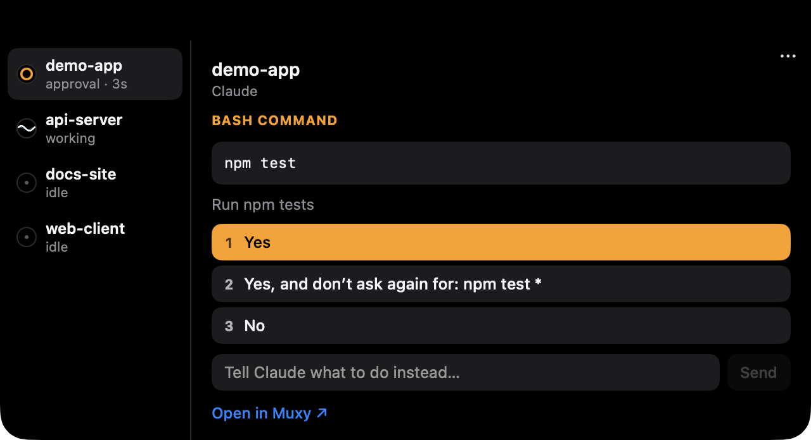
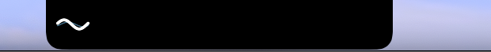
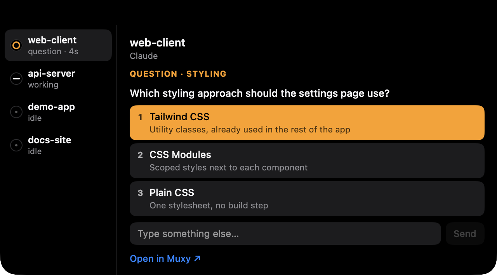
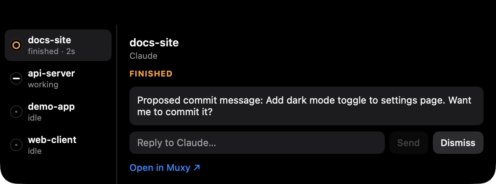
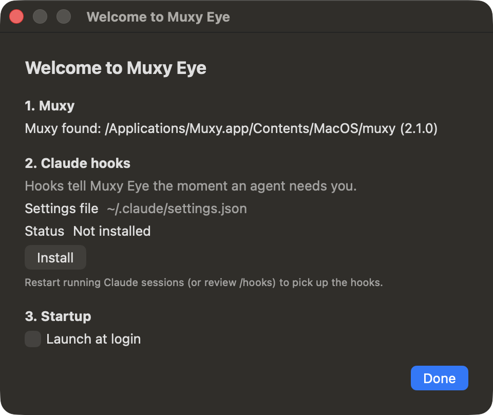
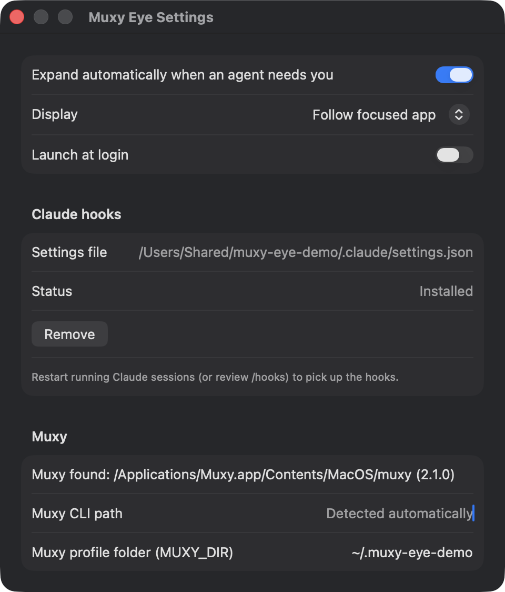

# Muxy Eye

Muxy Eye is a small macOS app that sits at the top center of your screen, styled like a Dynamic Island. It watches the coding agents running in your [Muxy](https://github.com/muxy-app/muxy) terminals. When a Claude Code session needs you (a permission prompt, a question, or a finished turn waiting for your next message), the eye turns into an orange ring. Click it to read the prompt and answer it without switching to Muxy. The terminal keeps working as usual, and whichever place answers first wins.

<p align="center">
  
</p>

<sub>The screenshots on this page come from a demo setup: sample projects, a separate Muxy profile, and a demo Claude settings file.</sub>

## The eye

The eye has three states:

| State | When | Look |
| --- | --- | --- |
| Idle | No agent is working or waiting | A flat, dim line that doesn't move |
| Working | At least one agent is working and none is waiting | A white wave scrolling across, with a fainter cyan wave behind it |
| Waiting | At least one session needs you | The line curls into an orange ring that pulses gently |

<p align="center">
  
  &nbsp;
  
</p>

A session counts as waiting when any of these holds:

- Muxy reports it as blocked (any agent);
- Claude Code has an open approval or question in it, or a finished turn you haven't seen yet;
- an agent other than Claude has a completion in Muxy that you haven't read.

Waiting wins over working. The change from wave to ring happens within about a second of the prompt appearing.

**Where it sits.**

- On a display with a notch, the eye extends the notch:
  - with nothing waiting, there is one wing, on the left, holding the eye;
  - while anything is waiting, a second wing on the right shows how many sessions are waiting.

  The eye stays on the left wing, so it never jumps sides.
- On a display without a notch, the eye is a small circle at the top center of the menu bar. With two or more sessions waiting, a count badge appears beside it.

The eye is on the display of the app you are working in, and it follows you when you switch. Settings can pin it to one display instead. It shows on every Space and over full-screen apps. Clicks are meant to land only on the visible shape, so the rest of the menu bar works as usual. That holds around a moved or enlarged eye and beside the open panel too: where the eye's window has room around what it shows, a click or a scroll there goes to whatever is below. That is checked by hand, as one of the items in the [QA checklist](docs/QA.md).

**Click** the eye to open the panel. **Right-click** it, or use the **⋯** button in the open panel's top-right corner, for Settings…, Hide for 1 Hour, and Quit Muxy Eye, plus Reset Position and Size once you have moved or resized the eye. Menu-bar tools such as Barbee can take right clicks in the menu bar, so the ⋯ button is always there. A hidden eye comes back after the hour, or when you start the app again.

**Moving and resizing.** You can put the collapsed eye anywhere on the screen, and make it smaller or larger:

- **Move:** press the eye (or its count) and drag it. It follows the pointer and stays where you let go. Grabbed by its count, or by the notch's wings, the eye's circle comes to the pointer as the drag starts. A drag never opens the panel; only a press that you release without moving it, by less than about 4 points, is a click.
- **Resize:** scroll over the eye, with a mouse wheel or on a trackpad. Scrolling up (the wheel or your fingers moving away from you) makes it larger, scrolling down smaller, from about half its usual size to about three times it. The count grows and shrinks with it. With natural scrolling on or off, the same movement grows it. Scrolled over the notch's wings, or beside the menu-bar eye, the circle it turns into comes under the pointer, so you can keep scrolling.
- **Shape:** once moved or resized, the eye is a free circle with the count beside it from two waiting sessions on, on every display, also on one with a notch (no wings). It stays on the screen, and it never goes behind the notch: dropped there, it moves just beside or below it.
- **Every display:** the eye keeps the same place relative to the screen, and the same size relative to its usual one, on every display. It still follows the display of the app you are working in, or the display pinned in Settings. Its place and size are kept when you quit and start the app again.
- **Reset:** once you have moved or resized it, the eye's menu (right-click or ⋯) has **Reset Position and Size**. It puts the eye back at the top centre at its usual size, with the notch's wings again on a notch display.

Only the collapsed eye can be moved or resized, not while the panel is open.

## The panel

The panel grows out of the eye, on the side of it chosen in Settings (**Panel opens**). With the eye at its default spot and the panel below it, the default, it drops down from the top of the screen. On the left, a rail lists every agent session Muxy knows about:

- the order is waiting sessions (oldest first), then working ones, then idle ones;
- each row shows a small eye in that session's state, the project name, and a short status: what it is waiting for and for how long (`approval · 2m`, `question · 40s`, `finished · 10s`), or `working` or `idle`;
- agents other than Claude show their provider (`Codex · working`). They show state only, without prompt content.

On the right is the selected session. Its header has the project name, the worktree and the agent. Below that is an orange label for the kind of prompt, then the prompt itself, then **Open in Muxy ↗**.

### Approvals

An approval, like the one at the top of this page, shows:

- the tool, such as `BASH COMMAND`;
- its input: the command, or the file it wants to touch;
- Claude's description of the action, when there is one;
- the numbered options exactly as Claude offers them in the terminal. Option 1 is highlighted.

Click an option, or press its number. To say no and tell Claude what to do instead, type in **Tell Claude what to do instead…** and press Return. Claude gets your text as its next prompt.

The options are shown only while the terminal shows that same prompt. If the prompt has moved on, or its layout can't be read, the panel shows the content without options, and Open in Muxy stays available.

### Questions

When Claude asks a question (its `AskUserQuestion` tool), the panel shows the question with its options and their descriptions.

<p align="center">
  
</p>

- **Single-select:** pick an option, or type your own answer in **Type something else…**.
- **Multi-select:** tick the checkboxes, then press **Submit**. Nothing is sent to the terminal until you submit.
- **Several questions at once:** they are shown one after another, in the same order as in the terminal.

### Finished turns

When Claude finishes a turn, the session waits until you have seen the result. The panel shows Claude's last message. Reply in **Reply to Claude…**, or press **Dismiss** to clear it.

<p align="center">
  
</p>

A finished turn also clears when you look at that pane in Muxy, or when you send Claude a new prompt from the terminal.

### Other sessions

- **Waiting, but no prompt details:** this happens for a blocked agent other than Claude, or for a Claude prompt that appeared before Muxy Eye or its hooks were running. The row says `needs input`, and the panel shows the last lines of the terminal as plain, read-only text, plus Open in Muxy. Muxy Eye never builds answer buttons from the terminal text alone.
- **Working or idle Claude sessions:** the panel shows the state, plus Claude's last message when Muxy Eye has seen one.

**Open in Muxy ↗** brings Muxy to the front, switching to its Space if it's on another one, opens the session's project, marks the session's Muxy alerts as read, and closes the panel.

**Closing.** The panel closes when you press Esc, when you click anywhere outside it, or about a second after the last waiting item is answered or cleared. While a message such as "Prompt changed" is showing, it stays open so you can read it.

### Keyboard

The keyboard goes to the panel only after you click the eye or the panel. Then:

| Key | Action |
| --- | --- |
| `1`–`9` | Pick that option. In a multi-select question, tick or untick it. |
| Return | Pick the highlighted option (option 1). In a multi-select question, submit. |
| ↑ / ↓ | Move through the session rail. |
| Esc | Close the panel. |

In a text field, Return sends the text and Esc closes the panel. Shortcuts with ⌘, ⌃ or ⌥ are left alone.

## Auto-expand

Turn on **Expand automatically when an agent needs you** in Settings. It is off by default. When it is on:

- the panel opens by itself whenever a session starts waiting: a new approval, question or finished turn, an agent that Muxy reports as blocked, or an unread completion from an agent other than Claude;
- it never opens while Muxy (or Muxy Beta) is the frontmost app, because then you are looking at the terminal already;
- it never takes keyboard focus, so whatever you are typing keeps going to the app you are typing in, and a stray key press can't answer a prompt. Click the panel when you want to use the keyboard there.

## How answering works

Muxy Eye mirrors the prompts. It doesn't own them.

- **Muxy** supplies the sessions and their states. Muxy Eye asks the `muxy` CLI every second while something is happening, and every three seconds when everything is idle.
- **Claude Code hooks** supply the content: the command, the question, Claude's last message. The hooks only report. They never answer, and Claude's own prompts in the terminal look exactly as before.
- **The terminal** supplies the exact list of options, and the final check before anything is typed.

When you answer, Muxy Eye:

1. reads the terminal again (`muxy session read-screen`);
2. checks that the prompt is still the one you were looking at, and that the terminal still shows it: the same kind of prompt and the same command or question (for a question, also the same options), with the option you picked still on screen.
   - If anything differs, for example because you already answered in the terminal, it types nothing and shows **Prompt changed — Open in Muxy**.
3. types the answer into that session, the way you would (`muxy session send` and `send-keys`):
   - an option is its number;
   - "No" with feedback picks No, waits for Claude's input prompt, then types your text and presses Return;
   - a free-text answer to a question picks "Type something", waits until its text field has the cursor, then types your text and presses Return;
   - a reply types your text and presses Return.

   Line breaks in your text become spaces, and control characters are removed, so a reply can't press Return or Esc early.
4. waits up to three seconds for Muxy to report that the session moved on. If it doesn't, it shows **Couldn't confirm — Open in Muxy**.

Only one answer per session is in flight at a time. If Muxy's server isn't running, Muxy Eye shows idle and waits. While `muxy server status` reports the server stopped, it runs no other `muxy` command, because those would start the server.

## Requirements

- macOS 14 Sonoma or later.
- Muxy 2.x. Muxy Eye uses the `muxy` CLI, protocol version 2, and warns if your Muxy speaks a different one. It has been tested with Muxy 2.1.0.
- Claude Code, running inside Muxy terminals. It has been tested with Claude Code 2.1.309.
- To build it: Xcode 26 or a Swift 6.2 toolchain or later.

## Build

```sh
swift test
scripts/build-app.sh release
open "build/Muxy Eye.app"
```

`scripts/build-app.sh` builds the app and its hook helper, assembles `build/Muxy Eye.app`, signs it ad hoc, and prints its path. You can move the app to `/Applications`. The hooks don't point into the app, so moving it doesn't break them.

## Setup

On first launch, Muxy Eye opens a short setup window.

<p align="center">
  
</p>

1. **Muxy:** where it found the `muxy` CLI, and its version. It looks for a path you set in Settings, then `~/.local/bin/muxy`, then the CLI inside `Muxy.app` or `Muxy Beta.app` in `/Applications`, then `muxy` on its `PATH`.
2. **Claude hooks:** **Install** adds Muxy Eye's hooks to Claude Code's settings. Without them, Muxy Eye still shows each session's state and the last lines of a waiting terminal, but it can't show the prompt's details or answer it. Already running Claude sessions pick up the hooks after a restart, or after you review them with `/hooks`.
3. **Startup:** launch Muxy Eye at login.

Press **Done** to finish, with or without the hooks. The setup window is shown once. Everything in it is also in Settings.

### What installing the hooks changes

- It edits `~/.claude/settings.json`. If Muxy Eye's environment sets `CLAUDE_CONFIG_DIR` to an absolute path, it edits `$CLAUDE_CONFIG_DIR/settings.json` instead.
  - Muxy Eye sees that variable only when you start it from a shell that sets it. Started from Finder, the Dock or at login, it doesn't see variables from your shell profile, so the hooks go into `~/.claude/settings.json`. Settings shows which file is in use.
- If the file exists, it first saves a copy next to it, as `settings.json.muxy-eye-backup-<date>`. The copy gets the same permissions as the original. The file is then saved again with its keys sorted, keeping its permissions. All other entries and values are kept.
- It adds one entry for each of `SessionStart`, `SessionEnd`, `UserPromptSubmit`, `PermissionRequest`, `PreToolUse` (only for `AskUserQuestion`), `PostToolUse`, `Notification` and `Stop`.
- Every entry runs `~/Library/Application Support/Muxy Eye/bin/muxy-eye-hook`. That is a copy of the helper bundled in the app, refreshed each time the app starts.
- Muxy Eye recognizes its own entries by `muxy-eye-hook` in the command. Install, Update and Remove only add or remove those entries.
- Muxy 1.x installed Claude hooks of its own (`muxy-claude-hook.sh`), and some settings files still contain them. Muxy Eye leaves them alone.

The helper does nothing for Claude sessions outside Muxy. It never prints anything, always exits successfully, and gives up within 200 ms when Muxy Eye isn't running or doesn't respond, so it never slows down or blocks Claude Code.

## Settings

<p align="center">
  
</p>

- **Expand automatically when an agent needs you:** see [Auto-expand](#auto-expand).
- **Display:** follow the focused app, or pin the eye to one display.
- **Panel opens:** below the eye (the default), above it, or to its left or right. If the panel has no room on that side, it opens on the opposite side, and it is always kept fully on the screen, clear of the Dock, and clear of the menu bar and the notch unless it hangs from the top of the screen. Below an eye in the menu bar (at its default spot, or moved or resized there), the panel hangs from the top of the screen as before, square on top and, on a notch display, with its content below the notch; above opens it there too, since there is no room above such an eye. Everywhere else the panel opens beside the eye, a few points from it and its count: it grows out of the eye and pulls back into it, and the eye stays visible, with its line and count, while the panel opens, is open and closes. Clicking the eye closes the panel, and clicks in the room between the two go to whatever is below. Only when neither side has room is the panel moved over the eye.
- **Launch at login:** if macOS refuses, the reason appears under the toggle.
- **Claude hooks:** the settings file in use, the hooks' status, and Install, Update or Remove.
- **Muxy CLI path:** set it if Muxy Eye can't find `muxy` by itself.
- **Muxy profile folder (`MUXY_DIR`):** set it to watch another Muxy profile, for example `~/Library/Application Support/Muxy Beta` for Muxy Beta. Leave it empty for the default profile.

Path changes apply when you press Return or leave the field. You can also open Settings when you start the app: `open "Muxy Eye.app" --args --settings`.

## Privacy

- Everything stays on your Mac. Muxy Eye makes no network connections.
- The hook helper passes Claude's prompts to the app over a Unix socket at `~/Library/Application Support/Muxy Eye/eye.sock`. The folder is readable only by you (`0700`), and so is the socket (`0600`). Other user accounts on the Mac can't read your prompts or send fake ones.
- Prompts are kept in memory only, never written to disk.
- Settings are stored in the `io.github.vybo.muxy-eye` defaults domain.
- The app isn't sandboxed, because it needs to run `muxy`, edit Claude's settings, and own the socket.

## Known limitations

- **Open in Muxy works per project.** It switches Muxy to the session's project, but it can't focus the exact tab or pane. Muxy has no way to do that from outside yet.
- **After several questions, you submit in the terminal.** Claude then shows a "Review your answers" screen. The eye shows it read-only, without a Submit answers button, so use Open in Muxy.
- **Multi-select inside a request with several questions isn't supported.** The eye may tick the boxes and then report **Couldn't confirm — Open in Muxy**. Finish that question in the terminal.
- **A draft at Claude's prompt can look empty.** Suppose you typed a draft at Claude's prompt and moved the cursor back to the start of the line. Muxy Eye can't tell that apart from Claude's grey prompt suggestion, so a reply from the eye would be typed in front of your draft.
- **Prompt content is for Claude Code only.** Other agents in Muxy show their state, but not their prompts.
- **Only sessions in Muxy terminals on this Mac are covered.** Claude sessions outside Muxy, and remote Muxy servers (`muxy --host`), are not covered.
- **Some prompt layouts can't be read.** If a Claude Code update changes how prompts look in the terminal, Muxy Eye can't read the options any more. Those prompts then show only Open in Muxy, rather than risk a wrong answer.

## Uninstall

1. In Settings, under Claude hooks, press **Remove**. Turn off **Launch at login** too.
2. Right-click the eye, or use the panel's **⋯** button, and choose **Quit Muxy Eye**.
3. Delete the app and the `~/Library/Application Support/Muxy Eye` folder.

Optionally, run `defaults delete io.github.vybo.muxy-eye`, and delete the `settings.json.muxy-eye-backup-*` copies next to Claude's settings.

Remove the hooks before deleting the folder. If you don't, Claude Code keeps trying to run a helper that is gone.

## License

[GNU Affero General Public License v3.0](LICENSE).
